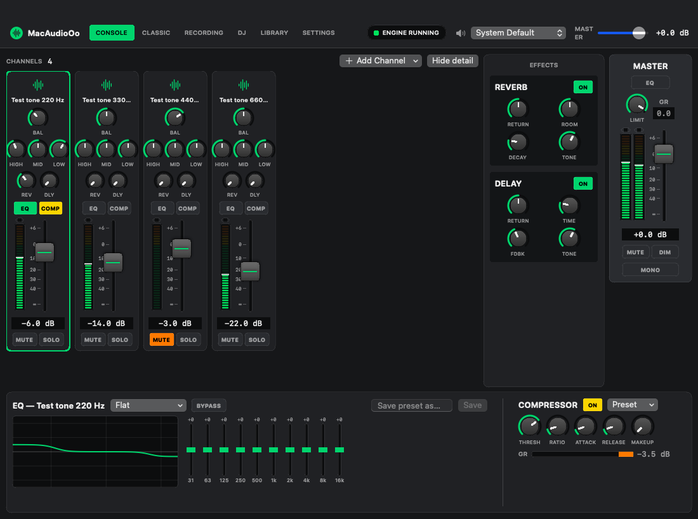

# Console (Phase 3)



*(Screenshot rendered on macOS 12.7.6 with four generated test tones as channels.)*

## Signal flow (all real-time, in `AudioMixer`)

```
source → EQ (10-band graphic + LOW/MID/HIGH tone) → compressor → fader/balance/mute/solo
       → sends (post-fader) → shared reverb / delay ─┐
       → channel sum ───────────────────────────────┴→ master EQ → master volume/DIM/MONO
                                                     → limiter → meters → output device
```

| Part | Implementation |
|---|---|
| Faders | Custom control, piecewise dB taper (-∞ … +6 dB), 10 ms click-free smoothing in the mixer, double-click resets to 0 dB |
| Meters | Real post-fader peak/RMS read from the render thread at 30 Hz (only while the Console is visible); green/yellow/orange segments, peak hold, latched clip lamp (click to reset) |
| Mute / Solo | Gate in the mixer; solo mutes every non-soloed channel |
| EQ | 10 peaking biquads (31.5 Hz … 16 kHz, Q 1.41, ±12 dB) + 3 tone filters; coefficients are computed on the UI thread and handed to the render thread via a flag; live response curve; presets (Flat, Bass Boost, Voice Clarity, Podcast, Night, Music, Cinema, Custom) and user presets saved in UserDefaults |
| Compressor | Stereo-linked, soft knee, dB-domain attack/release; threshold, ratio, attack, release, makeup; real gain-reduction meter; four starting presets |
| Reverb | Freeverb-style; return, room size, RT60 decay, tone; stable by construction (feedback derived from RT60, capped < 1) |
| Delay | Stereo feedback delay; return, time (smoothed), feedback (hard-limited to 85 %), tone |
| Master | Volume, mute, DIM (-20 dB), MONO, limiter threshold with GR readout, 10-band master EQ |

## Verified

32 unit tests (`scripts/test.sh`) on macOS 12.7.6: every EQ band hits its set gain (±0.5 dB), response curve
matches the measured response, EQ stable at +12 dB on all bands, compressor reduces loud and leaves quiet
signals alone, makeup gain, reverb decays and stays bounded, delay echo timing and feedback bound, a channel's
EQ/compressor does not affect another channel, master EQ affects the whole bus, sends only feed the reverb when raised.
The Console renders correctly on screen (screenshot above). Audible verification of each control was done
through the meters (`scripts/engine-smoke.sh`); the new UI was not yet exercised by hand on real application audio
(no capture backend is active on this Mac until the driver is installed).

## Not in the Console yet

- **GRP** group assignment, group faders, spill mode, scenes, undo/redo (Phase 7).
- **REC ARM** per channel (Phase 5).
- Application channels need a capture backend: Monterey driver (installed by you, see `DRIVER.md`) or, on macOS 14.2+, process taps (not implemented).
- Channel settings panel beyond EQ/compressor/sends, output routing per channel.
- Master reverb/delay *return* are in the Effects panel rather than the Master strip.
