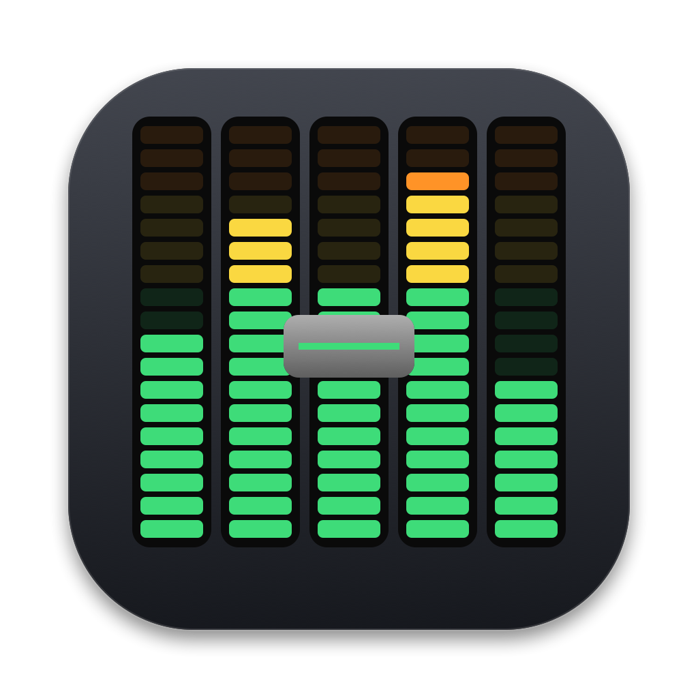
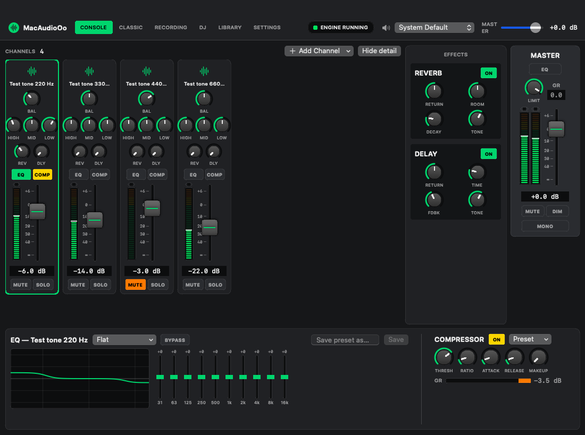
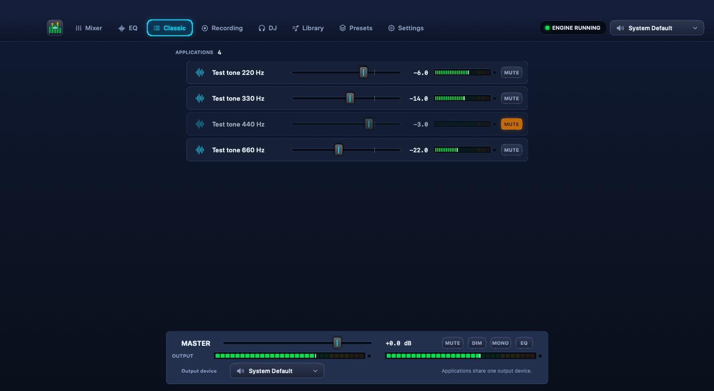
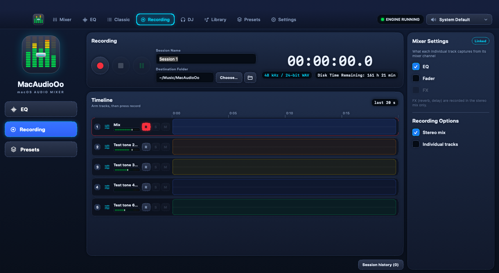
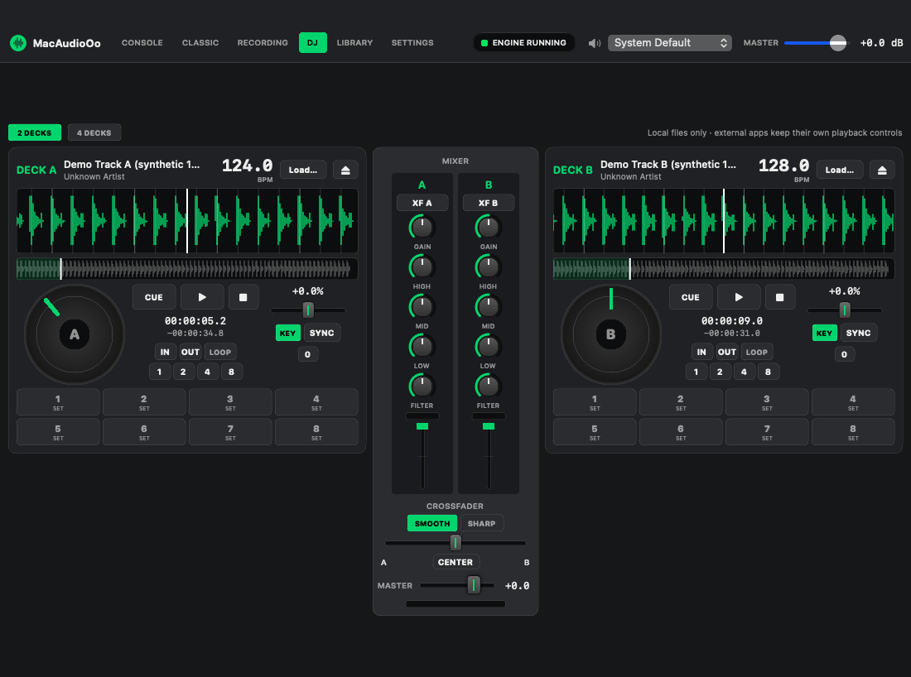
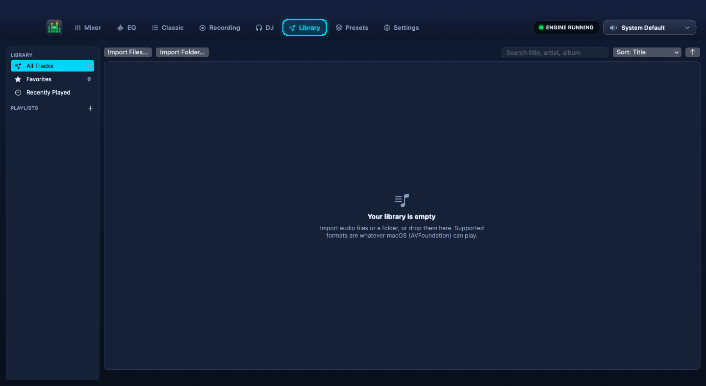

<p align="center"></p>

# MacAudioOo

**A native macOS audio mixer, recording studio and DJ workstation.**
Per-application volume, a 10-band EQ and compressor on every channel, shared reverb and delay, a master limiter,
multitrack WAV recording, and a two/four-deck DJ player with BPM detection and beat sync — all in one dark,
console-style window. Written in Swift/SwiftUI/AppKit on Core Audio. No account, no subscription, no network.



| Classic | Recording |
|---|---|
|  |  |
| **DJ** | **Library** |
|  |  |

*Screenshots are rendered by the app itself on macOS 12.7.6 using generated test tones and two synthetic demo tracks
(the analyzer measured exactly 124.0 and 128.0 BPM on them).*

## What it does

- **Console** – channel strips (meter, fader, balance, HIGH/MID/LOW, reverb/delay sends, EQ, COMP, GRP, REC, MUTE, SOLO), master
  section (volume, MUTE, DIM, MONO, limiter, master EQ), groups A–D (group fader, mute, solo, link, spill), scenes, undo/redo.
- **Classic** – the same engine as a compact list: volume, meter and mute per application, master volume/EQ, output device.
- **Recording** – real multitrack recording to 48 kHz / 24-bit stereo WAV: the stereo mix plus one dry stem per armed
  application, pause, live waveforms, disk-space readout, session history with playback, and automatic repair of recordings
  interrupted by a crash.
- **DJ** – two or four decks, jog wheels, scrolling waveforms, cue, hot cues, loops, key-lock time-stretch, BPM/beat-grid
  analysis, sync, 3-band EQ + filter per channel, crossfader, drag and drop. Local files only.
- **Library** – import files/folders (formats = whatever AVFoundation can play), artwork, search, sort, favorites, recently
  played, playlists.
- **Settings, menu bar, ducking** – launch at login, menu-bar volume control, automatic ducking of background apps while a
  call app is speaking, diagnostics log, config export/import.

## Which macOS can do what (honest table)

| macOS | How applications are captured | Independent per-app volume |
|---|---|---|
| **14.2+** | Core Audio process taps *(written, not yet tested on real hardware — see below)* | Yes |
| 13 – 14.1 | ScreenCaptureKit would be capture-only | **No** (cannot silence the app's own output) |
| **12 Monterey** | Optional separately installed virtual audio driver (included, `Driver/`) | Yes, after you install the driver and choose **MacAudioOo Mixer** as the system output |

MacAudioOo never installs anything or changes your default output device on its own, and the app says plainly in
Settings which of these applies on your Mac.

## Install

Two installers are published on the [Releases](../../releases) page:

- **`MacAudioOo-<version>-Monterey.dmg`** – macOS 12 and later, includes the optional audio driver.
- **`MacAudioOo-<version>-macOS13plus.dmg`** – macOS 13 and later, native capture, no driver.

Open the DMG and drag **MacAudioOo** to Applications. Details, the driver procedure and troubleshooting:
[Documentation/INSTALL.md](Documentation/INSTALL.md). Release builds are universal (Intel + Apple silicon).
Until a build is signed with a Developer ID and notarized, macOS will warn on first launch (right-click → Open).

## Status

This is a working beta. What has actually been verified, and on what, is written down in
[Documentation/TEST_RESULTS.md](Documentation/TEST_RESULTS.md) — read it before relying on anything:

- Verified on a MacBook Air (Intel, **macOS 12.7.6**): 93 automated tests, real-time engine on the built-in output, recording of
  the mix and stems from the live engine (re-read and checked), Console/Classic switching without interruption, DJ decks
  (offline render + on-screen), BPM analysis, the driver's shared-memory path (loaded like `coreaudiod` does, without installing).
- **Not yet verified:** the driver inside the real `coreaudiod` with real applications; process taps on macOS 14.2+;
  anything on macOS 13/14/15 or Apple silicon; output-device hot-plug on hardware.

## Build

Needs only the macOS Command Line Tools:

```bash
scripts/build.sh release            # build/MacAudioOo.app
scripts/test.sh                     # 93 unit tests
scripts/package.sh all              # both DMGs into dist/
```

See [Documentation/BUILD.md](Documentation/BUILD.md), [ARCHITECTURE.md](Documentation/ARCHITECTURE.md),
[AUDIO_BACKENDS.md](Documentation/AUDIO_BACKENDS.md), [DRIVER.md](Documentation/DRIVER.md) and
[RELEASE.md](Documentation/RELEASE.md).

## Not implemented (documented limitations)

Per-channel output routing and headphone cueing (the engine has one output path), a ScreenCaptureKit backend, user-facing
languages other than English, and anything for macOS < 12. Nothing in the UI is a placeholder for these: they are absent, not faked.

## License

Not yet chosen. Original code and assets only; no code or artwork from other applications is used.
